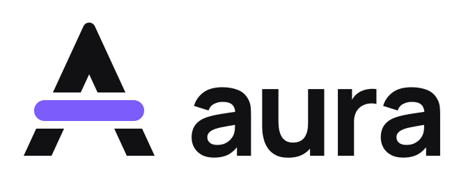
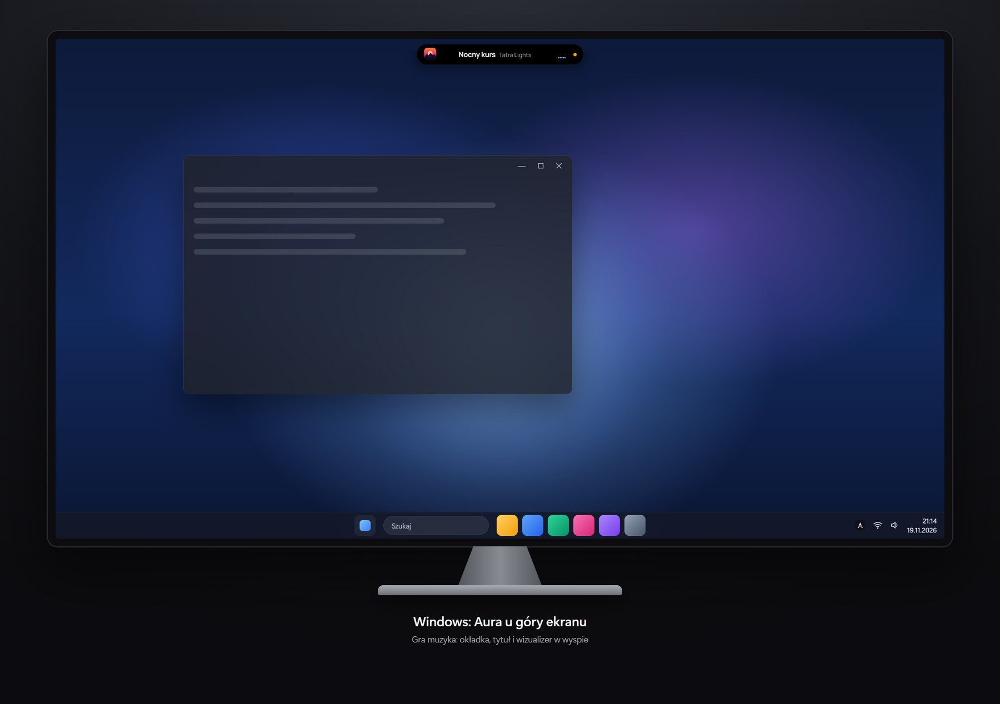
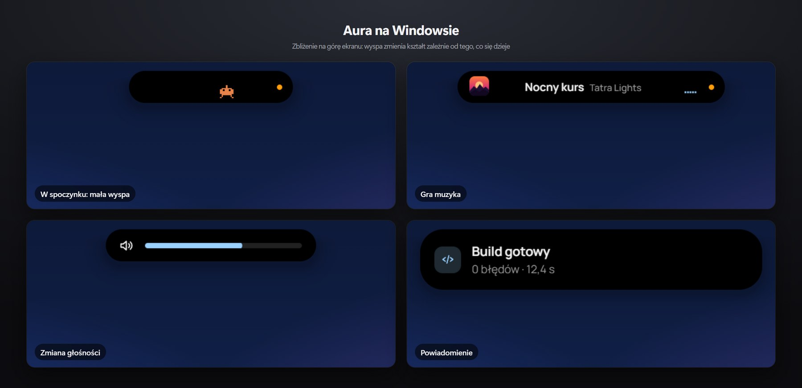
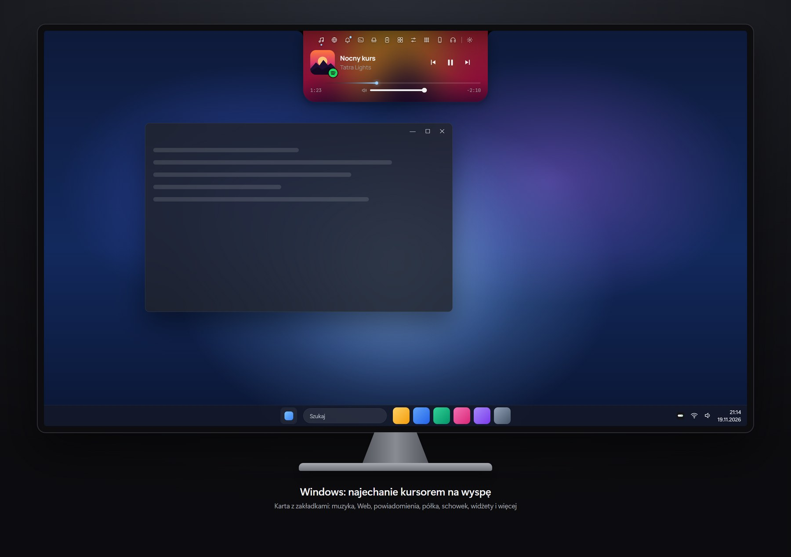
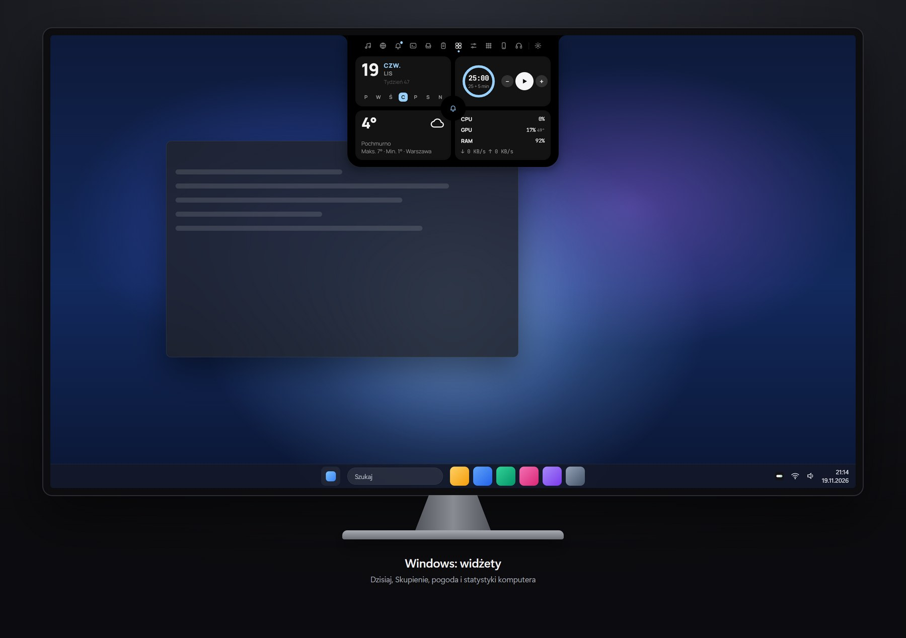
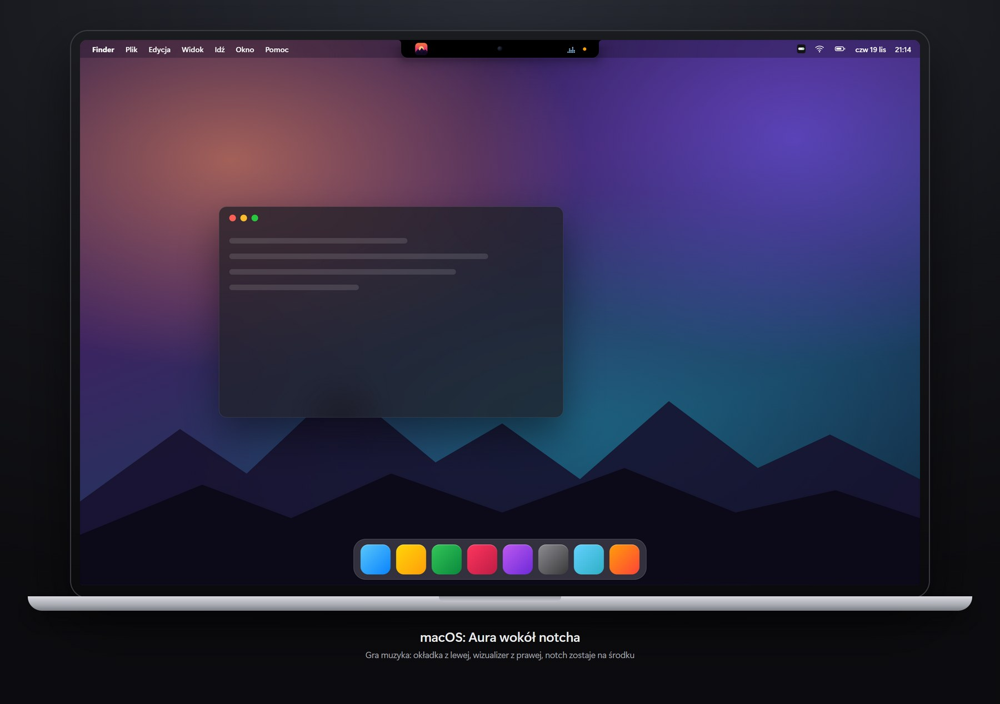
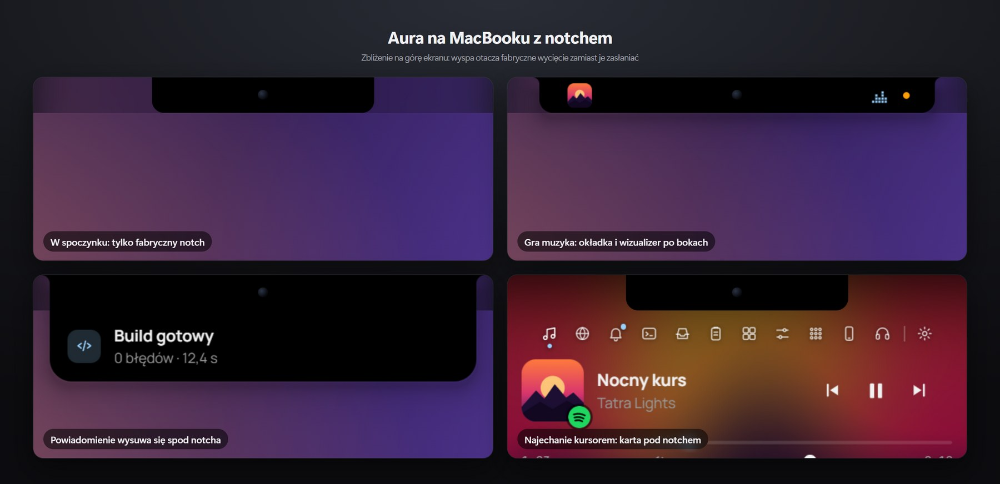
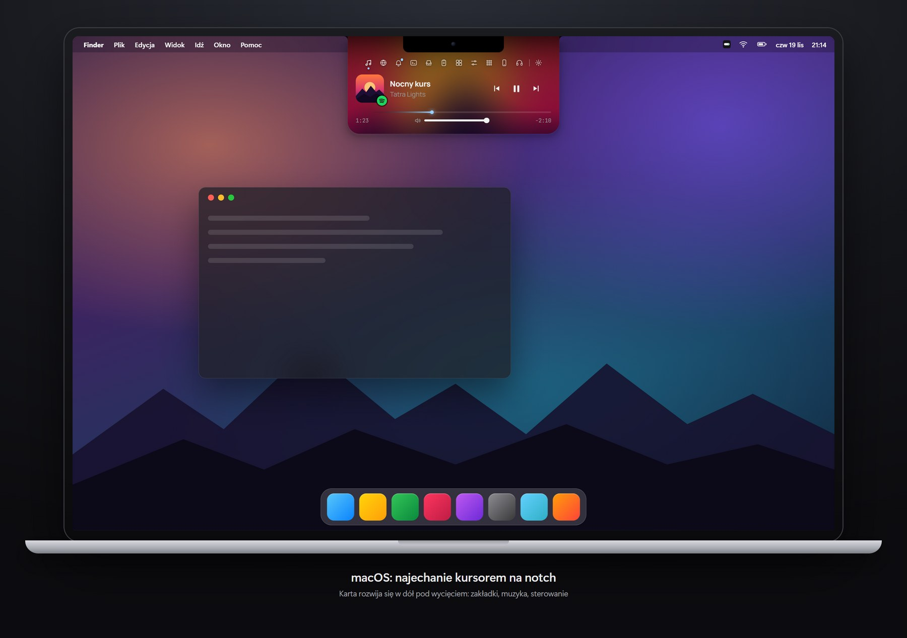
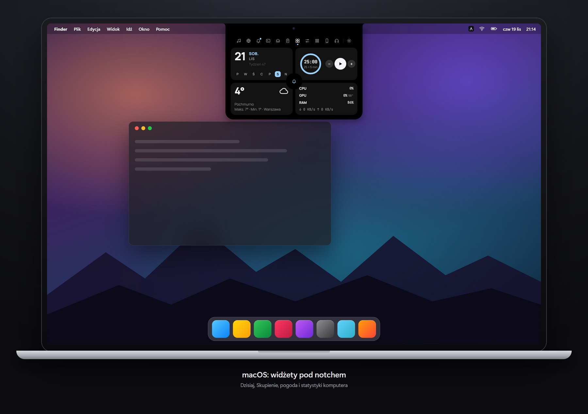

<p align="center">
  <picture>
    <source media="(prefers-color-scheme: dark)" srcset="brand/aura-logo-horizontal-color-dark.svg">
    
  </picture>
</p>

# Aura

**English** · [Polski](README.md)

**Aura** is a free "island" at the top of your Windows screen: music, a file shelf, clipboard history, widgets, reminders, system popups and AI agents in one pill that expands when you hover over it. The glass is real: the island blurs and bends whatever is underneath it, live.

Windows 10/11 and macOS (Electron). The app speaks **English and Polish**: it follows your system language by default, and you can switch it in **Settings → General → Language**. MIT license.

> Aura is an independent open-source project. It is not affiliated with Apple; "Dynamic Island" is a trademark of Apple Inc.

## Screenshots

### Windows





<table>
  <tr>
    <td></td>
    <td></td>
  </tr>
</table>

### macOS (MacBooks with a notch)





<table>
  <tr>
    <td></td>
    <td></td>
  </tr>
</table>

*Screenshots of the real app with sample data, placed in a device frame. The screenshots show the Polish interface.*

## Download

### Windows

1. Go to **[Releases](../../releases/latest)** and download `Aura-Setup-x.y.z.exe`.
2. Run the installer. Windows may show "Windows protected your PC", because the app has no paid code-signing certificate. Click **More info → Run anyway**.
3. Aura appears at the top of the screen and shows a short introduction. Its icon (the letter A with a purple island) sits in the tray next to the clock — click it to open the settings.

**Low on space on drive C:?** The installer always unpacks to a temporary folder on C: first (about 120 MB), even if you pick another drive. Download the portable version `Aura-x.y.z-portable.zip` instead: unpack it, e.g. to `D:\Aura`, and run `Aura.exe`. No installation, and all data is kept in the `dane` folder next to the program, so nothing of its own is written to C:.

Requirements: Windows 10 (2004 or newer) or Windows 11, 64-bit.

Installed Aura updates itself. After every update a **What's new** window lists the changes.

### macOS (MacBooks with and without a notch)

Download `Aura-x.y.z-mac-arm64.dmg` (Apple Silicon: M1, M2, M3, M4…) or `Aura-x.y.z-mac-x64.dmg` (Intel), open it and **drag Aura to the Applications folder**. Don't run it straight from the .dmg window — it stops opening once the image is ejected.

Aura has no paid Apple signature (Developer ID), so macOS warns that it "cannot verify that the app is free of malware". You see the same with any free app from outside the App Store without that signature. On the first launch:
1. In the warning click **Done** (not "Move to Bin").
2. Open **System Settings → Privacy & Security**, scroll down and next to Aura click **Open Anyway**, then confirm with your password or Touch ID.
   Or with one command in Terminal: `xattr -dr com.apple.quarantine /Applications/Aura.app`
3. When the first track plays, macOS asks whether Aura may control Spotify / Music — allow it.

Aura has no Dock icon: it lives in the menu bar (the icon next to the clock — on MacBooks with a notch it may hide behind the cut-out when there are many icons). Opening Aura again from Applications shows its settings.

On a Mac with a notch Aura wraps around the built-in cut-out: at rest you don't see it, and when something plays or a message arrives it slides out "wings" on both sides of the notch (cover on the left, visualiser or volume on the right). Hover over it and the card expands below the notch.

On macOS these work: music (Spotify and Apple Music), volume and microphone, shelf, clipboard, widgets, reminders, Web, OBS, chat, AI agents, screenshots and recording (after granting screen recording permission). Windows only: animated wallpaper, PC Deck, brightness, Wi-Fi, power mode, Caps Lock and the gamer bar. Glass on a Mac needs screen recording permission, so the default surface there is pure black.

## Features

- **Music** — cover and app icon (Spotify, browsers, VLC…), controls, smooth seeking, volume, a visualiser that reacts to the sound, song lyrics (optional, LRCLIB). Click the cover to open the app the music is playing from.
- **Glass** — blur and light bending at the edges, adjustable with a slider; also black, graphite, white and animated themes (Mountains, Night, Amber). The settings window uses the same glass.
- **Popups (HUD)** — volume, brightness, Caps Lock / Num Lock, microphone, headphone switch, power, colour under the cursor.
- **Device battery** (Windows) — mouse and headset battery in a capsule next to the island (Bluetooth and SteelSeries on a USB receiver), red ring from 20%, charging indicator.
- **Shelf** — drop files on the island and drag them on later; send to your phone with a QR code (both ways, same Wi-Fi network). AirDrop on a Mac.
- **Clipboard** — history encrypted with your Windows account, pinning; copies from password managers are skipped.
- **Widgets** — today and calendar (.ics), focus timer, weather (Open-Meteo), CPU / GPU / RAM / network.
- **Reminders** — with snooze and repeat.
- **Controls** — volume, brightness, Wi-Fi, Bluetooth, microphone for all apps, power mode.
- **Call** — a big button to mute the microphone everywhere, a call timer (Discord, Teams, Zoom, browsers…) and speaker and microphone selection right from the island.
- **Mac-style taskbar** (Windows, optional) — a dock with your apps, tray icons and the current track; it hides under windows and slides up at the bottom edge. It can be glass like the island, or black. Right-click an icon for the app's own shortcuts (e.g. Steam: Library, Store). The Windows taskbar comes back by itself when you turn it off or close Aura.
- **Island at the top or bottom** of the screen — at the bottom it moves together with the taskbar.
- **Launcher** — screenshot, snip, screen recording and six app slots.
- **Web** — favourite pages in a small browser under the island.
- **Phone (PC Deck)** — your phone as a touchpad and remote (music, slides, apps); you approve each phone on the computer.
- **Streaming** — a REC/LIVE pill from OBS (WebSocket), a Twitch chat drawer.
- **Animated wallpaper** — a video from your disk behind the desktop icons.
- **Games** — a thin CPU/GPU/RAM bar over a borderless full-screen game, or automatic hiding; Steam and Epic Games download progress on the island.
- **AI agents and scripts** — Claude Code and Codex session status on the island (hooks added with one button) and a local `127.0.0.1` endpoint for your own messages:

  ```
  curl -X POST http://127.0.0.1:47900/notify -d "{\"title\":\"Build\",\"body\":\"ready\"}"
  ```

- **A pet** at rest (cat, dog, rabbit, robot), a thin line under maximised windows, keyboard shortcuts for everything.
- **Introduction** on the first launch — a few cards about using Aura (later: Settings → About).

## Default shortcuts

| Action | Shortcut |
|---|---|
| Open / close the island | Ctrl+Alt+I |
| Hide / show | Ctrl+Alt+H |
| Play / pause | Ctrl+Alt+P |
| Focus timer | Ctrl+Alt+T |
| Mute the microphone (all apps) | Ctrl+Alt+M |
| Colour under the cursor | Ctrl+Alt+K |
| Screenshot | Ctrl+Alt+F |
| Screen recording | Ctrl+Alt+R |

Change them in Settings → Shortcuts.

## Privacy

No account, no ads, no telemetry. Only what you turn on leaves your computer:
- weather — the place name and coordinates to Open-Meteo,
- song lyrics (off by default) — the track title, artist and length to LRCLIB,
- Twitch chat — an anonymous connection to the chat of the channel you enter,
- calendar — downloading the .ics link you provide.

Glass reads the screen image locally only. Windows with glass are excluded from capture, so they don't show in screenshots or recordings (unless you turn on "Glass: island visible in screenshots"). Settings and data are in `%APPDATA%\Aura`.

## Run from source

```
git clone https://github.com/famefabricators-maker/aura.git
cd aura
npm install
npm start
```

Build the installer with `npm run dist` (output in `dist/`).

## Author

Made by **[FameFabricators](https://famefabricators.pl)**.

## License

MIT — details and library notices in [LICENSE](LICENSE).
