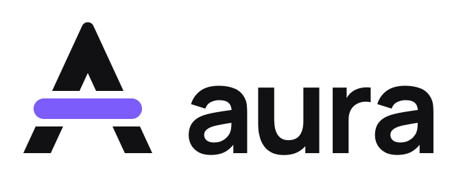
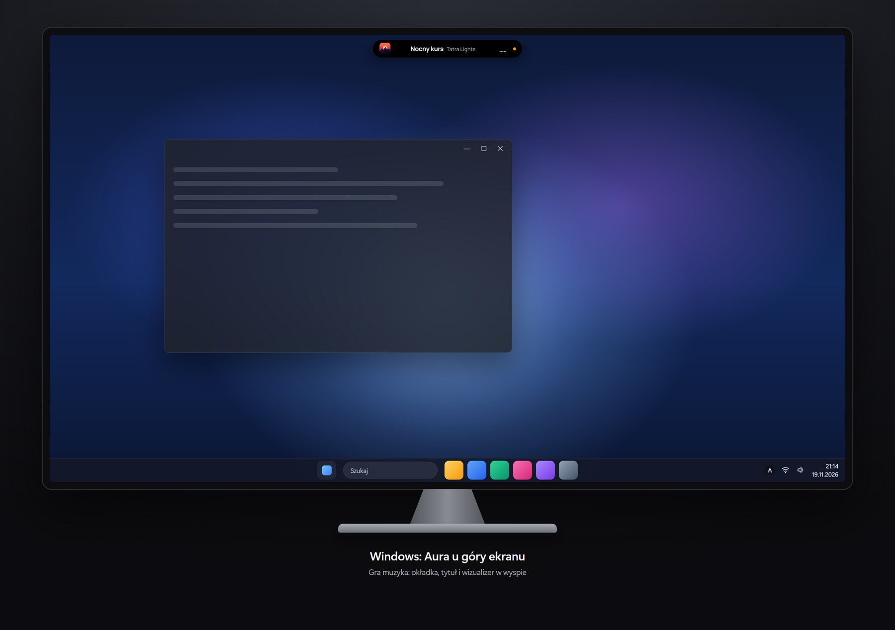
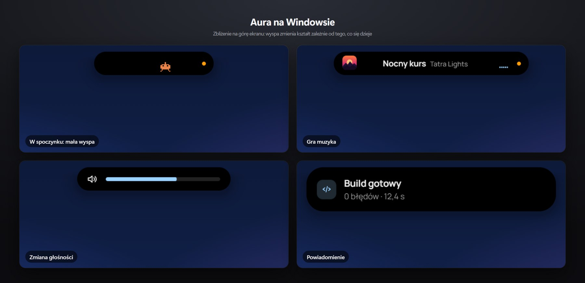
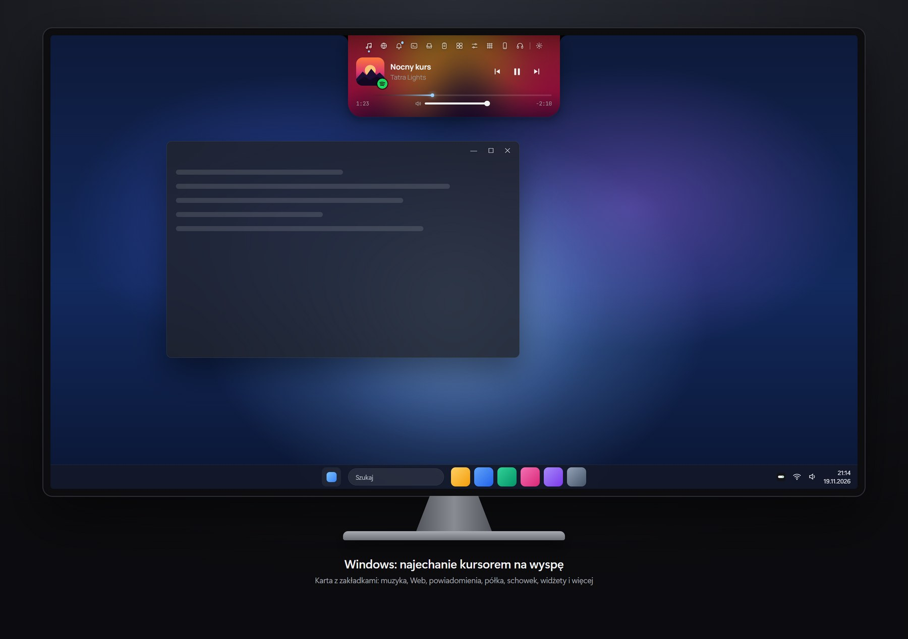
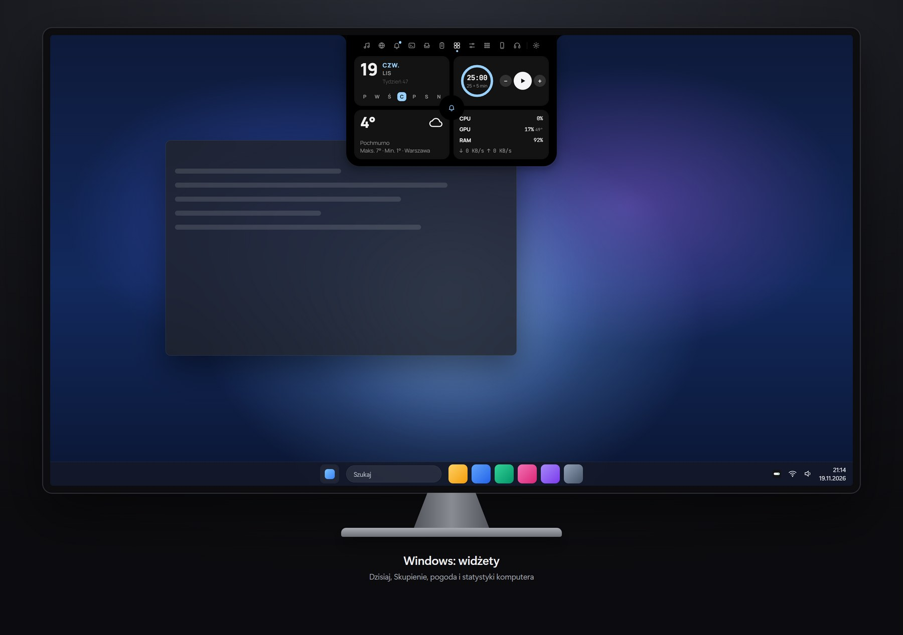
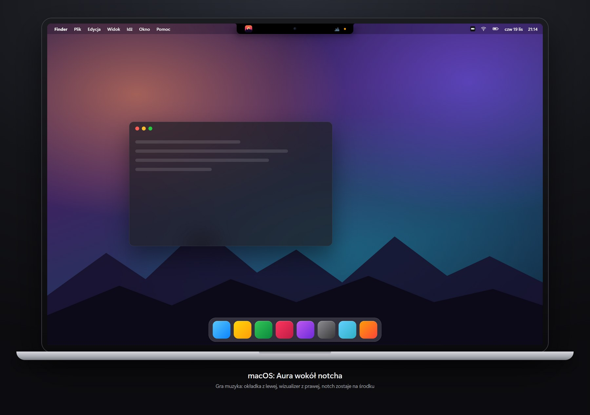
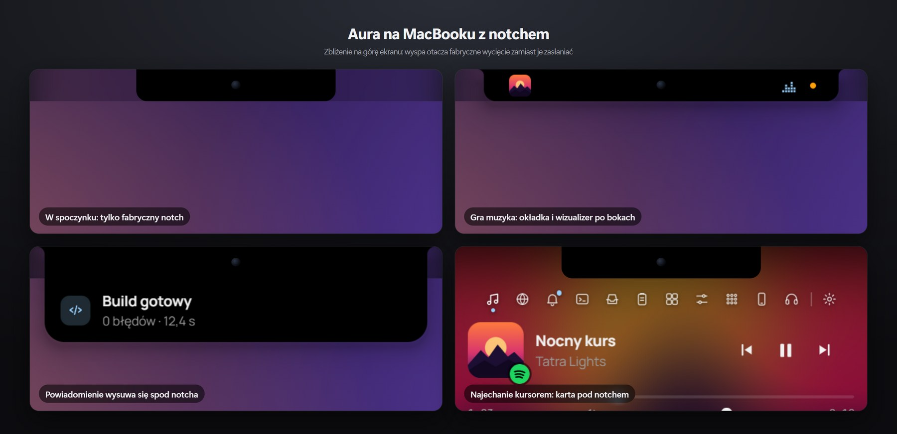
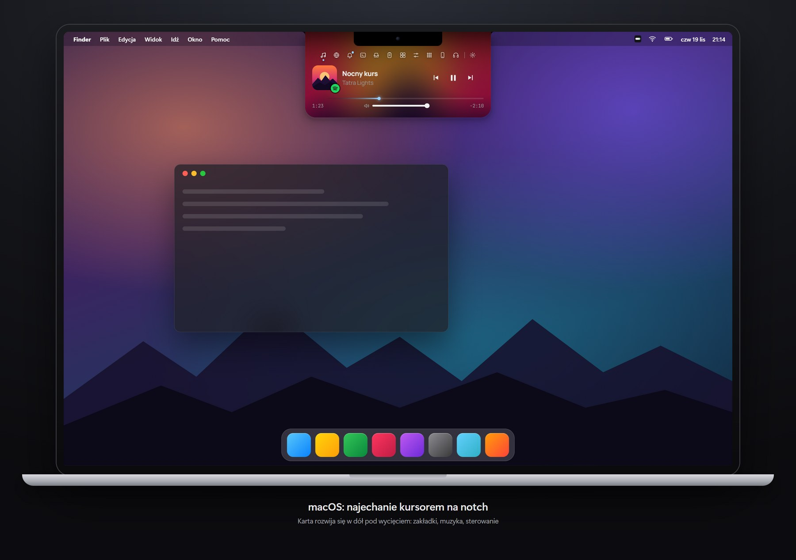
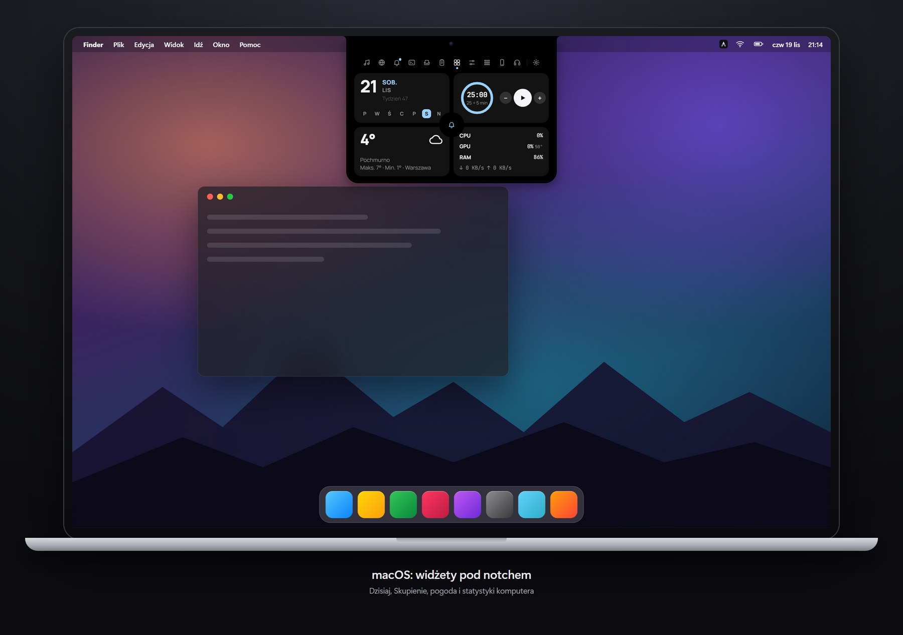

<p align="center">
  <picture>
    <source media="(prefers-color-scheme: dark)" srcset="brand/aura-logo-horizontal-color-dark.svg">
    
  </picture>
</p>

# Aura

**Aura** to darmowa „wyspa” u góry ekranu Windowsa: muzyka, półka na pliki, schowek, widżety, przypomnienia, komunikaty systemowe i agenci AI w jednej pigułce, która rozwija się po najechaniu kursorem. Szkło jest prawdziwe: wyspa na żywo rozmywa i załamuje to, co jest pod nią.

*A free Dynamic-Island-style notch for Windows 10/11 and macOS (Electron). UI in Polish. MIT license.*

> Aura jest niezależnym projektem open source. Nie jest powiązana z Apple; „Dynamic Island” to znak towarowy Apple Inc.

## Jak to wygląda

### Windows





<table>
  <tr>
    <td></td>
    <td></td>
  </tr>
</table>

### macOS (MacBooki z notchem)





<table>
  <tr>
    <td></td>
    <td></td>
  </tr>
</table>

*Zrzuty prawdziwej aplikacji na przykładowych danych, wstawione w obraz urządzenia. Na Macu układ przy notchu odtworzono na Windowsie w trybie podglądu.*

## Pobieranie

1. Wejdź w **[Releases](../../releases/latest)** i pobierz `Aura-Setup-x.y.z.exe`.
2. Uruchom instalator. Windows może pokazać „System Windows ochronił ten komputer”, bo aplikacja nie ma płatnego podpisu cyfrowego. Kliknij **Więcej informacji → Uruchom mimo to**.
3. Aura pojawi się u góry ekranu, a jej ikona w zasobniku obok zegara. Kliknięcie ikony otwiera ustawienia.

**Mało miejsca na dysku C:?** Instalator zawsze rozpakowuje się najpierw do folderu tymczasowego na C: (ok. 120 MB), nawet gdy wybierzesz inny dysk. Pobierz wtedy wersję przenośną `Aura-x.y.z-portable.zip`: rozpakuj ją np. na `D:\Aura` i uruchom `Aura.exe`. Bez instalacji, a wszystkie dane trzyma w folderze `dane` obok programu, więc na C: nie zapisuje nic swojego.

Wymagania: Windows 10 (2004 lub nowszy) albo Windows 11, 64-bit.
### macOS (MacBooki z notchem i bez)

Pobierz `Aura-x.y.z-mac-arm64.dmg` (Apple Silicon: M1, M2, M3, M4…) albo `Aura-x.y.z-mac-x64.dmg` (Intel), otwórz i **przeciągnij Aurę do folderu Aplikacje**. Nie uruchamiaj jej prosto z okna .dmg — po wysunięciu obrazu przestanie się otwierać.

Aura nie ma płatnego podpisu Apple (Developer ID), więc macOS ostrzega, że „nie może sprawdzić, czy aplikacja nie zawiera złośliwego oprogramowania”. To samo widać przy każdej darmowej aplikacji spoza App Store bez tego podpisu. Przy pierwszym uruchomieniu:
1. W ostrzeżeniu kliknij **Gotowe** (nie „Przenieś do Kosza”).
2. Otwórz **Ustawienia systemowe → Prywatność i ochrona**, przewiń na dół i przy Aurze kliknij **Otwórz mimo to**, potem potwierdź hasłem lub Touch ID.
   Albo jednym poleceniem w Terminalu: `xattr -dr com.apple.quarantine /Applications/Aura.app`
3. Przy pierwszym utworze macOS zapyta, czy Aura może sterować Spotify / Muzyką — zezwól.

Aura nie ma ikony w Docku: działa w pasku menu (ikona przy zegarze — na MacBookach z notchem może schować się za wycięciem, gdy ikon jest dużo). Ponowne otwarcie Aury z Aplikacji pokazuje jej ustawienia.

Na Macu z notchem Aura otacza fabryczne wycięcie: w spoczynku jej nie widać, a gdy coś gra lub przychodzi komunikat, wysuwa „skrzydełka” po bokach notcha (okładka z lewej, wizualizer lub głośność z prawej). Po najechaniu kursorem karta rozwija się w dół pod notchem.

Na macOS działają: muzyka (Spotify i Apple Music), głośność i mikrofon, półka, schowek, widżety, przypomnienia, Web, OBS, czat, agenci AI, zrzuty i nagrywanie (po zgodzie na nagrywanie ekranu). Tylko na Windowsie: animowana tapeta, PC Deck, jasność, Wi-Fi, tryb zasilania, Caps Lock i pasek dla graczy. Szkło na Macu wymaga zgody na nagrywanie ekranu, dlatego domyślna powierzchnia to czysta czerń.

## Co potrafi

- **Muzyka** — okładka i ikona aplikacji (Spotify, przeglądarki, VLC…), sterowanie, płynne przewijanie, głośność, wizualizator reagujący na dźwięk, teksty piosenek (opcjonalnie, LRCLIB).
- **Szkło** — rozmycie i załamanie światła na krawędziach, regulowane suwakiem; do wyboru też czarne, grafitowe, białe i motywy z animacją (Tatry, Noc, Bursztyn). Okno ustawień ma to samo szkło.
- **Komunikaty (HUD)** — głośność, jasność, Caps Lock / Num Lock, mikrofon, zmiana słuchawek, zasilanie, kolor spod kursora.
- **Półka** — upuść pliki na wyspę i przeciągaj je dalej; wysyłanie na telefon kodem QR (w obie strony, ta sama sieć Wi-Fi).
- **Schowek** — historia szyfrowana kontem Windows, przypinanie, kopie z menedżerów haseł są pomijane.
- **Widżety** — dzień i kalendarz (.ics), minutnik skupienia, pogoda (Open-Meteo), CPU / GPU / RAM / sieć.
- **Przypomnienia** — z drzemką i powtarzaniem.
- **Sterowanie** — głośność, jasność, Wi-Fi, Bluetooth, mikrofon dla wszystkich aplikacji, tryb zasilania.
- **Launcher** — zrzut ekranu, wycinek, nagrywanie ekranu i sześć miejsc na aplikacje.
- **Web** — ulubione strony w małej przeglądarce pod wyspą.
- **Telefon (PC Deck)** — telefon jako gładzik i pilot (muzyka, slajdy, aplikacje); każdy telefon zatwierdzasz na komputerze.
- **Streaming** — pigułka REC/LIVE z OBS (WebSocket), szuflada z czatem Twitcha.
- **Animowana tapeta** — film z dysku za ikonami pulpitu.
- **Gry** — wąski pasek CPU/GPU/RAM nad grą pełnoekranową albo automatyczne ukrywanie.
- **Agenci AI i skrypty** — stan sesji Claude Code na wyspie (hooki dodawane jednym przyciskiem) oraz lokalny punkt `127.0.0.1` do własnych komunikatów:

  ```
  curl -X POST http://127.0.0.1:47900/notify -d "{\"title\":\"Build\",\"body\":\"gotowy\"}"
  ```

- **Zwierzak** w spoczynku (kot, pies, królik), wąski pasek pod zmaksymalizowanymi oknami, skróty klawiszowe do wszystkiego.

## Domyślne skróty

| Akcja | Skrót |
|---|---|
| Otwórz / zamknij wyspę | Ctrl+Alt+I |
| Ukryj / pokaż | Ctrl+Alt+H |
| Odtwórz / wstrzymaj | Ctrl+Alt+P |
| Minutnik skupienia | Ctrl+Alt+T |
| Wycisz mikrofon (wszystkie aplikacje) | Ctrl+Alt+M |
| Kolor spod kursora | Ctrl+Alt+K |
| Zrzut ekranu | Ctrl+Alt+F |
| Nagrywanie ekranu | Ctrl+Alt+R |

Skróty celowo omijają Ctrl+Alt z literami ą ć ę ł ń ó ś ź ż (to AltGr na polskiej klawiaturze). Zmienisz je w Ustawienia → Skróty.

## Prywatność

Bez konta, reklam i telemetrii. Z komputera wychodzi tylko to, co sam włączysz:
- pogoda — nazwa miejsca i współrzędne do Open-Meteo,
- teksty piosenek (domyślnie wyłączone) — tytuł, wykonawca i długość utworu do LRCLIB,
- czat Twitcha — połączenie anonimowe z czatem kanału, który wpiszesz,
- kalendarz — pobranie podanego linku .ics.

Szkło czyta obraz ekranu wyłącznie lokalnie. Okna ze szkłem są wykluczone z przechwytywania, więc nie widać ich na zrzutach ani nagraniach. Ustawienia i dane są w `%APPDATA%\Aura`.

## Uruchomienie z kodu

```
git clone https://github.com/famefabricators-maker/aura.git
cd aura
npm install
npm start
```

Instalator buduje `npm run dist` (wynik w `dist/`).

## Autor

Stworzone przez **[FameFabricators](https://famefabricators.pl)**.

## Licencja

MIT — szczegóły i informacje o bibliotekach w pliku [LICENSE](LICENSE).
